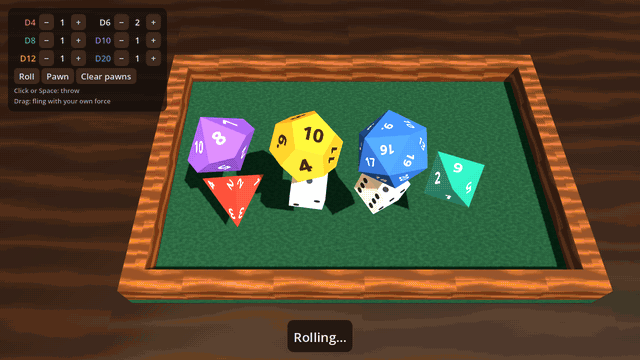

# Godot Dice

Physically simulated dice in a wooden tray, built with Godot 4.7: throw a handful of D4–D20, watch them tumble, read the result when they stop.



**Live web build:** [pscactux.github.io/godot-dice](https://pscactux.github.io/godot-dice/)

## Features

- D4, D6, D8, D10, D12 and D20, up to 12 dice at once, chosen with the panel in the top-left corner.
- Click/tap or press Space to throw. Drag across the tray to fling the dice yourself: the direction and speed of the drag set the throw.
- The dice tumble, collide and settle (Jolt physics). Once every die has stopped, the panel at the bottom shows each result and the total, and a number floats above each die.
- All geometry and markings are generated in code: pips on the D6, numbers on the other dice (D4 uses corner numbers like a real one). There are no external models, textures or fonts.
- Soft shadows, a procedural wood rim and a felt floor.
- Extra: drop board-game pawns onto the tray (`Pawn` button or `P`) and knock them over.
- Runs on desktop and in the browser (Compatibility renderer), with a portrait layout for phones.

## Run it

1. Install [Godot 4.7](https://godotengine.org/download).
2. Open `project.godot` in the editor and press Play, or run `godot --path .` from this folder.

Test (headless, takes a few seconds):

```sh
godot --headless --path . --fixed-fps 60 -s tests/test_dice.gd
```

It checks that every face of every die reads back correctly, then simulates 280 throws (1,200 D6 results plus mixed D4–D20 throws). It fails if a throw does not settle, if a die ends on an invalid or cocked face, or if the D6 chi-square goes over 20.5 (5 degrees of freedom, p = 0.001). `--fixed-fps` makes every frame advance exactly 1/60 s, so the simulation runs as fast as the CPU allows.

Screenshot and GIF (opens a window, needs `ffmpeg` for the GIF):

```sh
godot --path . --fixed-fps 30 --resolution 1280x720 -s tools/capture.gd -- --frames=/tmp/dice-frames
tools/make_gif.sh /tmp/dice-frames
```

Keep the window visible while it runs: macOS stops drawing hidden windows, and the capture waits for each frame to be drawn.

Web export: the `Web` preset writes to `build/web/`. On every push to `main`, `.github/workflows/pages.yml` downloads Godot 4.7.1, runs the test, exports the web build and deploys it to GitHub Pages. To use it, set Settings → Pages → Source to "GitHub Actions". The build is single-threaded, so GitHub Pages does not need special headers.

## How it works

**Shapes.** Each die starts as a list of vertices: the regular solids for D4/D6/D8/D12/D20, and a pentagonal trapezohedron for the D10, with the pole height chosen so the kite faces are flat. A small brute-force convex hull finds the faces. Opposite faces get values that add up to sides + 1. The same vertices are used for the mesh and for the `ConvexPolygonShape3D` collider.

**Reading the result.** Each die keeps a list of local "read directions" with their values. For most dice these are the face normals. A D4 has no top face, so it is read from the vertex that points up. The result is the direction whose rotated vector has the largest dot product with world up. That dot product also gives how flat the die is lying.

**Settling and cocked dice.** A die counts as stopped after it stays below a small linear and angular speed for 0.35 s. When all dice have stopped, any die whose best alignment is below 0.97 (about 14° off flat) is cocked: it is leaning on a wall, a pawn or another die. Those dice get a small random upward impulse and torque, and the roll keeps going until every die is flat. A die that never comes to rest also gets nudged after 12 s.

**Physics settings.** Jolt physics with gravity at 30 m/s² (the dice are about 1.5 units across, and normal gravity looks floaty at this scale). Continuous collision detection is on for the dice. Friction is 0.55 and bounce 0.3 on the dice, the felt has more friction and less bounce than the wood, and the dice have some angular damping so they stop rolling sooner. Tall invisible walls and a ceiling keep everything inside the tray.

**Randomness.** Every die in a throw gets a uniformly random orientation (Shoemake's method), a random spin axis with 8–22 rad/s of spin, and a small random change to the shared throw velocity. A click throws from a random point on the near edge toward a random target. A drag uses the tray points under the start and end of the drag, and the drag speed sets the throw strength.

## Project structure

```
project.godot          Godot project (Compatibility renderer, Jolt physics)
main.tscn              Single scene; everything else is built in code
scripts/
  die_shapes.gd        Vertices, convex hull, face values, face reader
  die.gd               RigidBody3D die: mesh, collider, pips/numbers
  roller.gd            Throwing, settle detection, cocked-die nudges
  tray.gd              Tray colliders and procedural wood/felt materials
  main.gd              Camera, lights, input, UI, pawns
tests/test_dice.gd     Headless reader + simulation test
tools/capture.gd       Screenshot / frame capture for docs
tools/make_gif.sh      Frames -> docs/demo.gif with ffmpeg
export_presets.cfg     Web export preset
.github/workflows/     GitHub Pages deployment
```

## License

MIT, see [LICENSE](LICENSE).
